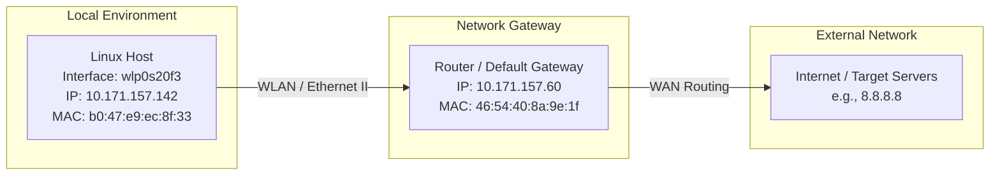
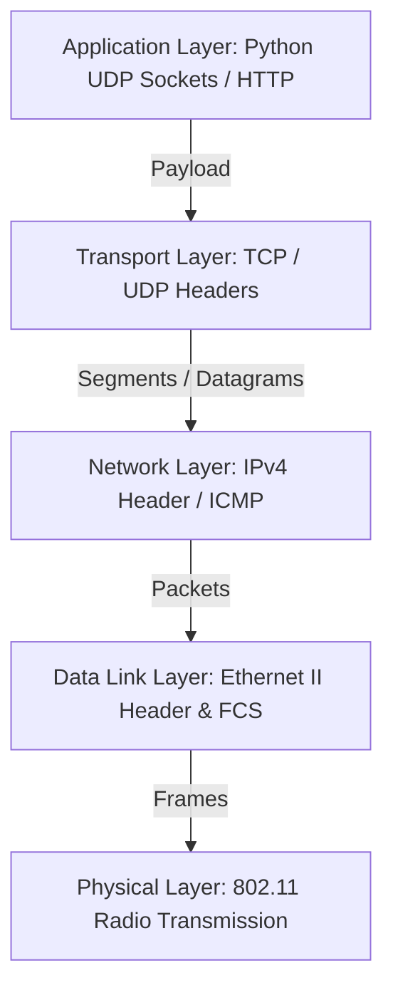

# Ethernet Communication Investigation and Traffic Analysis using Linux


## 📌 Project Overview
This repository documents a comprehensive investigation into Ethernet and TCP/IP communication protocols on a Linux platform. Designed as a practical network engineering portfolio piece, this project moves beyond theoretical concepts by executing live packet captures on a physical wireless interface, generating custom telemetry traffic via Python sockets, and diagnosing Layer 2 to Layer 4 behaviors using standard Linux networking utilities.

**Primary Objectives:**
- Dissect the IEEE 802.3 Ethernet frame structure and TCP/IP encapsulation.
- Differentiate between Layer 2 (MAC) physical addressing and Layer 3 (IPv4) logical routing.
- Analyze the operational mechanics of ARP, ICMP, TCP, and UDP protocols.
- Validate network behavior using `iproute2`, `net-tools`, and Wireshark.

---

## 🏗️ Network Topology & Environment

Unlike virtualized namespace simulations, this investigation captures real-world traffic traversing a live physical network stack.



**System Specifications:**
* **OS:** Ubuntu 24.04.02 LTS
* **Hardware:** Lenovo IdeaPad Slim 5
* **Capture Interface:** `wlp0s20f3`
* **Analysis Engine:** Wireshark 4.2.2

---

## 🗂️ Repository Architecture

```text
📦 Ethernet-Traffic-Analysis
 ┣ 📂 docs/
 ┃ ┣ 📂 source/                 # Markdown source files for the reports
 ┃ ┣ 📜 Study_Report.pdf        # Theoretical breakdown of OSI layers and Ethernet protocols
 ┃ ┗ 📜 Analysis_Report.pdf     # Practical correlation of captured packets to network theory
 ┣ 📂 logs/
 ┃ ┗ 📂 tools/                  # Raw text outputs from Linux terminal network utilities
 ┣ 📂 screenshots/              # Visual evidence of Wireshark captures and handshakes
 ┣ 📂 scripts/
 ┃ ┣ 📜 udp_client.py           # Custom Python socket script for generating UDP telemetry
 ┃ ┗ 📜 udp_server.py           # Custom Python socket script for receiving UDP telemetry
 ┗ 📂 wireshark/                # Raw .pcapng files for local deep-packet inspection
```

---

## 🛠️ Practical Diagnostics (Linux Networking Tools)

Before analyzing raw packets, system-level networking tools were used to establish the baseline configuration and routing rules of the host machine.

| Utility | Primary Function | Observed Output Summary |
| :--- | :--- | :--- |
| `ip addr` | Interface state & addressing | Identified `wlp0s20f3` active state, MTU, and `10.171.157.142/24` allocation. |
| `ip route` | Routing table mapping | Confirmed `10.171.157.60` as the default gateway for external traffic. |
| `arp -a` | ARP Cache mapping | Validated the Layer 2 to Layer 3 bridge mapping IP `10.171.157.60` to MAC `46:54:40:8a:9e:1f`. |
| `ping` | ICMP Reachability | Measured RTT and verified bidirectional connectivity to `8.8.8.8`. |
| `ss` / `netstat` | Socket statistics | Mapped active listening ports, established TCP connections, and UDP sockets. |

---

## 🔍 Deep Packet Inspection (Wireshark Analysis)

### Protocol Encapsulation Flow
Data captured during this project demonstrates the strict top-down encapsulation model of the TCP/IP stack.



### 1. ARP (Address Resolution Protocol)
* **Objective:** Map a known IP to an unknown MAC address.
* **Observation:** After flushing the local ARP cache, an outbound ARP Request broadcast (`Who has 10.171.157.60? Tell 10.171.157.142`) was captured, followed immediately by a unicast ARP Reply from the router providing its physical MAC address.

### 2. ICMP (Internet Control Message Protocol)
* **Objective:** Test network diagnostics and host reachability.
* **Observation:** Captured `Type 8` (Echo Request) and `Type 0` (Echo Reply) packets. Validated that while the MAC address changes at the router boundary, the logical IPv4 addresses remain persistent end-to-end.

### 3. TCP (Transmission Control Protocol)
* **Objective:** Analyze connection-oriented, reliable data transfer.
* **Observation:** Successfully isolated the TCP Three-Way Handshake (`[SYN]`, `[SYN, ACK]`, `[ACK]`) initiated by an HTTP request, verifying sequence number synchronization and port allocation (e.g., local ephemeral port to destination port `80`).

### 4. UDP (User Datagram Protocol)
* **Objective:** Analyze connectionless, high-speed data transfer suited for telemetry.
* **Observation:** Utilized custom `udp_client.py` and `udp_server.py` scripts to generate traffic. Wireshark captures confirmed the absence of a handshake or teardown phase, highlighting UDP's lower overhead compared to TCP.

---

## 🚀 Execution & Reproduction

To reproduce this analysis on a local Debian/Ubuntu machine:

1. **Clone the repository:**
   ```bash
   git clone https://github.com/siddharth-dere/Ethernet-Traffic-Analysis.git
   cd Ethernet-Traffic-Analysis
   ```
2. **Review Packet Captures:**
   Open the `.pcapng` files in the `wireshark/` directory using the Wireshark GUI for granular frame inspection.
3. **Run UDP Telemetry Scripts:**
   ```bash
   # Terminal 1: Start the server
   python3 scripts/udp_server.py
   
   # Terminal 2: Execute the client payload
   python3 scripts/udp_client.py
   ```